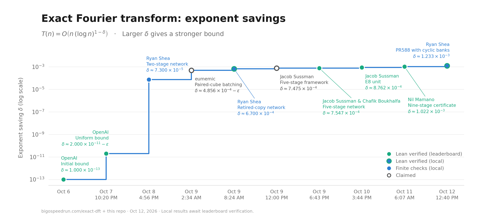

# Finite Network Improvements for the Exact Discrete Fourier Transform

A living research project on **OpenAI Math Problem #130**, *An explicit power saving for the exact discrete Fourier transform*. We study how improvements to the complex networks developed around integer multiplication (#109) transfer to all-length Fourier bounds.



<sub>Leaderboard history through 2026-10-12; the new local result below is not yet a leaderboard entry. The [Big O Speedrun exact-DFT leaderboard](https://bigospeedrun.com/exact-dft) lists our 7.3e-5 and 6.7e-4 results as Claimed. Our 6.7e-4 result has a [Lean proof](lean/round11/) that passes the official comparator (Lean and nanoda kernels) locally; it uses the round-eleven circuit in Sussman's five-stage layout, not our written transfer. The 7.3e-5 point is backed by exact finite certificates, not Lean. Regenerate with `python3 scripts/render_progress_chart.py` (requires Matplotlib).</sub>

<!-- current-result:start -->

## Latest paper

**[Read the latest paper (PDF)](manuscript.pdf)** · [Read online (Markdown)](manuscript.md) · [LaTeX source](tex/manuscript.tex)

This is the complete current paper: the reusable Fourier argument, the selected network construction and the improvement history. These links stay the same as the paper is updated; earlier versions are preserved under [archive/](archive/).

Current selection: **[PR588 circuit with source copies and cyclic banks](results/complex588.md)**, recorded 2026-10-12.

```math
T(n)=O\left(n(\log n)^{1-\delta}\right),\qquad \delta=0.0012331685.
```

**A new instantiation checked by Lean.** It combines Jeremy Kothe's PR588 circuit and its community predecessors, Jacob Sussman's formal engine, Dugongue and jacklightChen's #401/#377 geometry, Nil Mamano's published gauged Lean extension, and OpenAI's all-length reduction. The exact all-length DFT and convolution statements pass the statement and axiom checks. Independent human mathematical review remains pending.

The exponent saving is approximately **12.332 billion times** OpenAI's [published headline](https://github.com/openai/math/blob/main/preprints/An-explicit-power-saving-for-the-exact-discrete-Fourier-transform-September-25-2026/main.pdf) of `delta=1e-13`. It is **63.39% above** the [previous selection](results/five-stage-pr233.md) of `delta=0.000754736`. These ratios compare exponent parameters, not measured runtimes.

The Fourier saving is chosen below the checked complex-tensor witness `a=0.0012331686`, leaving a positive gap to absorb the Fourier reduction's overhead. The integer-multiplication headline `kappa` is a separate parameter.

The [finite certificate](verification/certificates/complex588_reference.json) binds the pinned witness, recursive cost certificate, exact rate and absorption gap to the Lean source. The [Lean reproduction receipt](lean/complex588/receipt/verification.json) records the build and theorem/definition comparisons for the all-length DFT and convolution. See [the audit](verification/COMPLEX588_AUDIT.md) for its scope and limits.

<!-- current-result:end -->

The model uses exact complex arithmetic, unrestricted coefficients, a specified supplied root of unity, and unit-cost logarithmic-word indexing. Scalar preparation and array organization are included. These are asymptotic exponent improvements; **no practical FFT speedup is claimed**.

## Paper structure and result history

- [Improvement log](IMPROVEMENTS.md): dated results, exact parameters, provenance and changes.
- [Reusable transfer theorem](paper/framework.md): the finite-network contract, recurrence, array adapters, and all-length reduction.
- [Versioned result records](results/README.md): construction arguments and the process for adding future updates.

The paper title and general theorem stay stable as new networks arrive. Each update gets its own record, pinned sources, verifier and reference certificate. A candidate is not promoted by a numerical certificate alone. `results/registry.json` explicitly selects the current result and generates the headline and log.

## What this project contributes

The finite circuits, general geometry and Fourier framework belong to their cited authors. This project supplies earlier proposed transfers into #130's uniform array model and additional finite checks. The current update gives a **new Lean-checked instantiation**: PR588's local circuit with explicit source copies and a cyclic dedicated-bank schedule, yielding all-length saving `0.0012331685`. That is about **20.65% above** the pinned prior verified saving `0.0010221076`. The integer-multiplication headline is a separate parameter; the native conditional hosting argument is not used as a premise.

We acknowledge **OpenAI** for the original framework and Fourier reduction; **Douglas (Doug) Colkitt** for early network research, the independently sized complex construction that informed our first paper, and community integration; **Rohan Arun** for fixed-basis/corner composition and the weighted-matching precedent explicitly credited by Jain; and **Swapnil Jain** for our adopted round-six, round-ten and round-eleven complex witnesses. This order introduces the research context; it is not a ranking of contributors.

Our adopted Jain constructions also depend on **icekylinx** (batching, frames, covers, paired cubes and retirement reuse), **eumemic** (producers, modules, frames and late compensation), **an664** (completed-core sharing), **James Chang / jamesyc** (birth reuse and terminal compilation), **DaysSky** (carrier extensions), and **Chafik Boukhalfa / chafreaky** (the terminal paired-cube lineage and a related local configuration). **Aurel Prosz / Paureel**, **Avi Eisenberg / ikeboy**, **Zhihao Chen / jacklightChen**, and other earlier contributors retain their specific source credits.

The current bound uses the **PR588 circuit submitted by Jeremy Kothe**, including **DominikScholz's**, **jon314159's**, **eumemic's**, and **Chafik Boukhalfa's** cited refinements. **Jacob Sussman** supplies the Lean engine and checkers; **Dugongue** and **Zhihao Chen / jacklightChen** supply the #401/#377 geometry; **Nil Mamano's** published submission supplies the gauged Lean extension; **OpenAI** supplies the exact model and all-length reduction. Our additions are the source-copy conversion, cyclic bank schedule and checked instantiation. See [the result](results/complex588.md), [audit](verification/COMPLEX588_AUDIT.md), [full notices](lean/complex588/NOTICE.complex588), and [attribution history](ATTRIBUTION.md).

The [previous five-stage selection](results/five-stage-pr233.md) remains intact, with Sussman, Boukhalfa, icekylinx, eumemic, Avi Eisenberg, SovereignSteak, hcg890 and its other predecessors retaining their credits. Its [assembled publication](archive/five-stage-pr233/manuscript.pdf) is preserved.

This work is AI-assisted. Additional verifiers written with the same assistant are not independent mathematical review. The selected all-length theorem has a checked Lean proof. The earlier Jain arithmetic certificates do not formalize those earlier transfers, and the reusable written exposition has not thereby all been formalized. Separately, [lean/round11](lean/round11/) contains a Lean proof at the round-eleven saving `delta=0.00067`, using that circuit in Sussman's five-stage layout; it checks the saving with that circuit, not our written three-stage transfer. Preserved upstream notices retain contributor-specific AI disclosures. Earlier project work used GPT-6 Pro and GPT-6-Astra Max; the current integration and checks were developed with Codex.

## Reproduce and update

Standard-library Python **3.10+**:

```sh
python3 verification/run_checks.py
```

For the selected finite witness and retained proof receipt:

```sh
python3.11 verification/verify_complex588.py
```

Reproduce the Lean proof separately with Lean 4.34.1 installed:

```sh
cd lean/complex588
bash scripts/build_and_check.sh build-logs
```

The full suite includes the new circuit, bank schedule, exact moment, mutation controls and source/receipt bindings. It retains every earlier finite verifier, including the five-stage program, round-ten and round-eleven frame checks, and rational moments. These are finite checks; the full DFT algorithm is not executed. The main Python runner does not execute Lean; the separate reproduction command above does. See [verification scope](verification/README.md).

Rebuild the paper, generated result summary and log with Pandoc and pdfLaTeX:

```sh
python3 scripts/build_manuscript.py
```

`--markdown-only` regenerates text without compiling the PDF; `--check` checks registry/certificate agreement and generated text freshness. The [update workflow](results/README.md) explains how to preserve prior artifacts and incorporate a new witness.

## Preserved results

- [Round-eleven record](results/round11.md), with its [unchanged publication snapshot](archive/round11/README.md).
- [Round-ten record](results/round10.md), with its [assembled draft snapshot](archive/round10/README.md), captured before incorporating round eleven in the same update.
- [Round-six record](results/round6.md), with its unchanged [publication PDF](archive/round6/manuscript.pdf) and source snapshot.
- [Earlier shared-sum record](results/legacy-shared-sum.md), with its unchanged [publication PDF](archive/three-stage/manuscript.pdf).
- [Short core proof](core-proof.pdf), retaining the simpler `5.2e-10` and `5.3e-10` fallbacks.

All previous verification suites remain runnable. Historical audit records apply only to their named constructions.

## Original sources

OpenAI's [#130 Fourier manuscript](https://github.com/openai/math/blob/main/preprints/An-explicit-power-saving-for-the-exact-discrete-Fourier-transform-September-25-2026/main.pdf) supplies the exact-arithmetic model, Fourier compiler and all-length reduction. The network research originates in [#109](https://github.com/openai/math/blob/main/preprints/Integer-multiplication-below-n-log-n-September-23-2026/paper.pdf) and [Douglas Colkitt's community repository](https://github.com/CrocSwap/integer-mult-bounds). Construction-specific sources, immutable commits, licenses and contribution credit are recorded with each version.

## License

Original code, manuscripts and documentation in this repository are licensed under the [Apache License, Version 2.0](LICENSE), except where otherwise indicated. Copyright 2026 Ryan Shea.

Third-party material, including vendored sources and source archives, retains its original licenses and notices. See [NOTICE](NOTICE), the [attribution audit](ATTRIBUTION.md), and the source-specific licenses and notices under [verification/vendor/](verification/vendor/).
